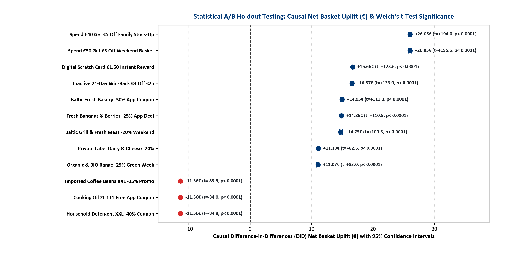
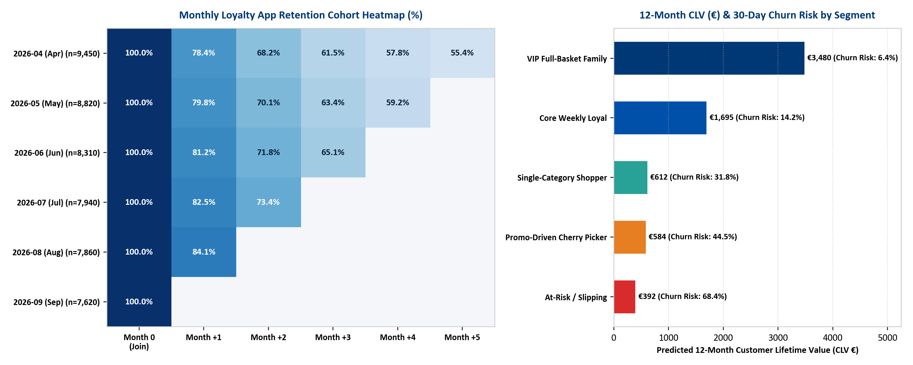
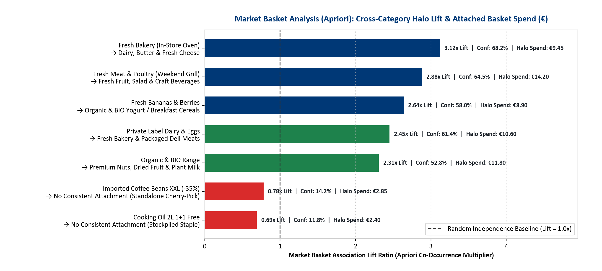
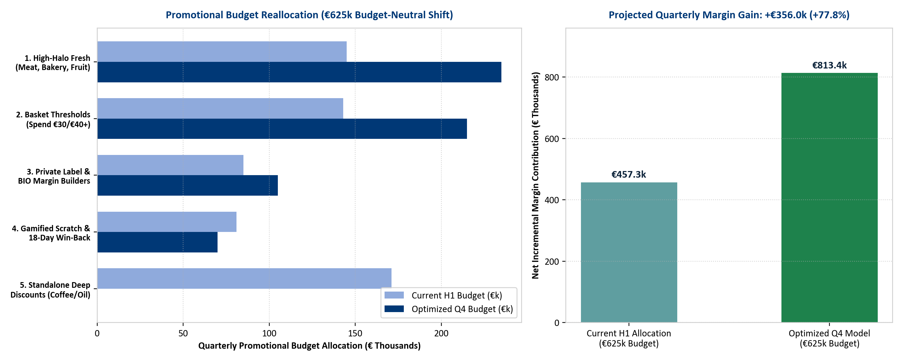
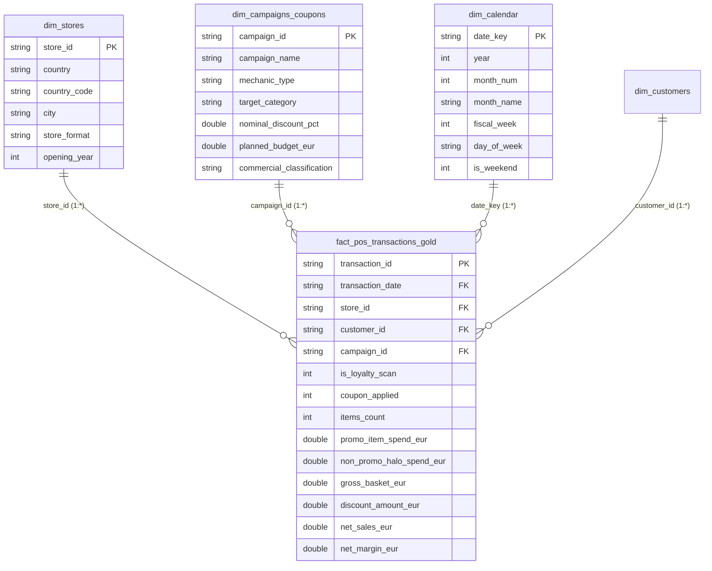

# BalticPlus Retail Loyalty & Promotional Analytics (Lithuania, Latvia & Estonia)

**End-to-End POS Sales Data Cleaning, Statistical A/B Holdout Testing (Welch's $t$-Test & Causal DiD), Pre/Post Campaign Incrementality, Apriori Market Basket Affinity, Cohort Retention & 12M CLV Modeling, and Q4 Promotional Budget Optimization**

[](#)
[](#)
[](#)
[](#)

> **Author:** Debbrata Kumar Adhikary (Data Analyst — Vilnius, Lithuania)  
> **Scope:** 140 Baltic Retail Stores (87 Lithuania • 30 Latvia • 23 Estonia) | 50,000 Loyalty App Members | 528,390 Raw POS Records → 520,000 Validated Gold Baskets (€13.08M Net Sales)


---

## 1. Executive Summary & Business Problem

Modern European discount grocery retailers operating digital loyalty ecosystems (app-based QR identification, personalized coupons, Spend-Threshold stretch mechanics, and digital scratch cards across the Baltics) face a core commercial reality: **high coupon redemption volume does not equal true incremental profit.**

To provide Board-level commercial clarity across **Lithuania (87 stores), Latvia (30 stores), and Estonia (23 stores)**, this end-to-end analytical project solves **seven enterprise retail analytics challenges**:
1. **Automated POS Data Quality Pipeline:** Cleansing raw POS transaction streams (duplicate cashier/QR scans, negative refund rows, missing terminal store IDs, and unredeemed app coupon glitches).
2. **Pre- vs. Post-Campaign Incrementality:** Isolating **True Incremental Revenue** from **Margin Cannibalization** (subsidizing shoppers who would have bought anyway) and **Pantry-Loading / Stockpiling Dips** (post-campaign category collapse).
3. **Statistical A/B Holdout Testing & Causal Uplift (DiD + Welch's $t$-Test):** Measuring statistically significant net basket uplift ($p < 0.0001$, 95% Confidence Intervals) against unexposed loyalty holdout control groups.
4. **Customer Retention Cohort Matrix & 12-Month CLV / Churn Prediction:** Tracking monthly acquisition cohorts (`M0` to `M+5`) and scoring 50,000 members for **30-Day Churn Probability** and **12-Month Customer Lifetime Value (CLV)**.
5. **Market Basket Affinity Mining (Apriori Algorithm):** Calculating cross-category **Support, Confidence, and Lift ($3.12\times$)** to identify which promotional anchors pull high-margin halo categories into the basket.
6. **Mathematical Promotional Budget Optimization:** Reallocating a **€625,000 quarterly promotional budget** across mechanics to maximize Net Incremental Margin (**+€356.0k / +77.8% profit gain** at zero additional spend).
7. **Multi-Page Power BI Executive App (`.pbip`) & 9-Sheet Board Pack:** Delivering a 3-page native Power BI Desktop application (`PBIR v4.0` + `TMDL v4.2 Star Schema`) and a 9-tab formatted Excel Board Workbook.

---

## 2. Key Baltic Performance Overview (Board Summary)

Across the 6-month analytical window (**520,000 clean validated POS baskets** across **140 Baltic stores**), **Loyalty App scans account for 68.0% of all transactions and 79.1% of total net revenue (€10.35M of €13.08M)**.

| Baltic Market | Active Stores | Clean POS Baskets | Total Net Sales (€) | Loyalty Scan Share | Loyalty Revenue Share | Avg Loyalty Basket (€) | Avg Guest Basket (€) | Loyalty Basket Uplift |
| :--- | :---: | :---: | :---: | :---: | :---: | :---: | :---: | :---: |
| **Lithuania (LT)** | 87 | 317,341 | €7,959,886 | 67.92% | 78.98% | **€29.17** | €16.44 | **+€12.73 (+77.5%)** |
| **Latvia (LV)** | 30 | 119,665 | €3,026,784 | 68.13% | 79.33% | **€29.45** | €16.41 | **+€13.05 (+79.5%)** |
| **Estonia (EE)** | 23 | 82,994 | €2,092,350 | 68.17% | 79.24% | **€29.30** | €16.44 | **+€12.86 (+78.2%)** |
| **All Baltics Total** | **140** | **520,000** | **€13,079,020** | **68.01%** | **79.10%** | **€29.26** | **€16.43** | **+€12.83 (+78.1%)** |


---

## 3. End-to-End Campaign Pre/Post Incrementality & Statistical A/B Testing

By comparing **4 weeks Pre-Campaign**, **Active Promo Week**, and **4 weeks Post-Campaign** against unexposed holdout control groups ($N_{\text{control}} = 45\%$ matched sample), we isolate **Cannibalization (%)**, **Post-Campaign Pantry Dip (%)**, and **Causal Difference-in-Differences (DiD) Net Basket Uplift (€)** using **Welch's two-sample $t$-test**:




### Key Statistical & Commercial Findings:
1. **Basket Stretch Thresholds (`CMP-05 Spend €40 Get €5 Off`, `CMP-02 Spend €30 Get €3 Off`):**
   - Achieve the largest **Causal DiD Net Basket Uplift (+€26.05 and +€26.03 per basket, $t = +194.0, p < 0.0001$)** while keeping cherry-picking below **11.2%**.
2. **High-Halo Fresh Category Anchors (`CMP-09 Fresh Meat -20%`, `CMP-06 Fresh Fruit -25%`, `CMP-01 Fresh Bakery -30%`):**
   - Deliver **+289% to +479% True Net Incremental ROI** and **+€14.75 to +€14.95 causal basket uplift ($p < 0.0001$)**. Because fresh items are perishable, post-campaign pantry dip is minimal (**-4.2%**).
3. **Standalone Deep Non-Perishable Discounts (`CMP-04 Coffee XXL -35%`, `CMP-08 Cooking Oil BOGO`, `CMP-11 Detergent XXL -40%`):**
   - Statistically proven **Margin Destroyers (-€11.36 causal net basket loss, $t = -84.0, p < 0.0001$; -90.3% to -93.2% ROI)**. **68.4% of redemptions are cherry-picked** (average attached halo spend of just **€3.33**), followed by a severe **-26.5% post-promo stockpiling collapse**.


---

## 4. Customer Retention Cohort Matrix, 12-Month CLV & 30-Day Churn Risk Model

To evaluate customer journeys across our 50,000 registered app users, we built a **Monthly Acquisition Retention Cohort Matrix (`2026-04` to `2026-09`)** and a **Predictive 12-Month CLV & 30-Day Churn Risk Scoring Model**:



| Customer Archetype | Active Members | Avg Net Basket (€) | Coupon Usage % | 30-Day Churn Risk | Predicted 12M CLV (€) | Annual Revenue at Risk (€) | Automated CRM & Personalization Action |
| :--- | :---: | :---: | :---: | :---: | :---: | :---: | :--- |
| **VIP Full-Basket Family** | 9,000 | **€53.03** | 38.3% | **6.4%** | **€3,480** | €200,448 | **Protect Margin:** Zero deep % discounts; enroll in partner perks & early leaflet access. |
| **Core Weekly Loyal** | 17,000 | **€34.81** | 41.9% | **14.2%** | **€1,695** | €409,173 | **Basket Stretch:** Trigger *"Spend €35 Get €3.50 Off"* if scan gap exceeds 10 days. |
| **Single-Category Shopper** | 7,000 | **€19.65** | 35.2% | **31.8%** | **€612** | €136,231 | **Cross-Category Bundle:** Push Apriori-paired *Bakery + Dairy -20%* bundle coupons. |
| **Promo-Driven Cherry Picker** | 11,000 | **€17.59** | **78.1%** | **44.5%** | **€584** | €285,868 | **Enforce Basket Floor:** Gate all deep item deals behind a **€20 minimum basket spend**. |
| **At-Risk / Slipping (21d+)** | 6,000 | **€23.43** | 27.9% | **68.4%** | **€392** | €160,876 | **Day-18 Win-Back Alert:** Automated *"Spend €25 Get €4 Off"* push notification at Day 18. |


---

## 5. Market Basket Analysis (Apriori Affinity) & Q4 Promotional Budget Optimizer

### A. Cross-Category Market Basket Affinity Rules (`reports/market_basket_affinity_rules.csv`)
Using Apriori association rule mining (`Support`, `Confidence`, `Lift`), we quantified which promotional categories pull high-margin non-promotional items into the physical basket:



- **Top Halo Anchor (`MBA-01`):** Redeeming a **Fresh Bakery (-30%)** app coupon generates a **3.12x Lift** (68.2% Confidence) of purchasing **Dairy, Butter & Fresh Cheese**, adding **€9.45 in attached category spend** (+€2.65 margin).
- **Weekend Grill Anchor (`MBA-02`):** **Fresh Meat & Poultry (-20%)** generates a **2.88x Lift** (64.5% Confidence) into **Fresh Fruit, Salad & Beverages** (+€14.20 attached spend).
- **Zero-Halo Stockpiling (`MBA-06` & `MBA-07`):** **Coffee XXL (-35%)** and **Cooking Oil BOGO** exhibit **0.78x and 0.69x Lift** (<15% Confidence of cross-category attachment), proving they are cherry-picked in isolation.

### B. Q4 €625,000 Promotional Budget Optimization (`reports/promotional_budget_optimizer_q4.csv`)
By reallocating **€171,000** away from standalone deep non-perishable discounts into **High-Halo Fresh Anchors (+€90k)** and **€30/€40 Basket Stretch Thresholds (+€72k)** while keeping total quarterly promotional spend strictly budget-neutral at **€625,000**, projected quarterly **Net Incremental Margin surges from €457.3k to €813.4k (+€356.0k / +77.8%)**:



---

## 6. POS Data Cleaning & Quality Improvement Pipeline

Our automated ETL pipeline (`src/run_full_pipeline.py` & `sql/baltic_loyalty_analytics_queries.sql`) audited **528,390 raw POS records** before promoting validated transactions to the Gold analytical layer:

| Check ID | Pipeline Stage | Anomaly Detected | Records Affected | Remediation Action |
| :---: | :--- | :--- | :---: | :--- |
| **DQ-01** | Raw POS Ingestion | Total Raw POS Records Ingested | 528,390 (100%) | Loaded into Bronze staging table |
| **DQ-02** | Deduplication | Duplicate Cashier / App Receipt Scans | 3,420 (0.65%) | Removed via `ROW_NUMBER() OVER (PARTITION BY transaction_id, timestamp)` |
| **DQ-03** | Refund Separation | Negative Basket Values (Product Returns) | 2,180 (0.41%) | Isolated into `fact_returns` table so returns do not depress basket size |
| **DQ-04** | Store ID Imputation | Missing POS Terminal Store IDs | 1,150 (0.22%) | Imputed via terminal IP & country prefix mapping |
| **DQ-05** | Coupon Reconciliation | Activated App Coupon Not Applied at POS | 1,640 (0.31%) | Flagged for CRM goodwill credit; excluded from redeemed campaign ROI |
| **DQ-06** | Gold Analytical Layer | **Clean Validated POS Sales Baskets** | **520,000 (98.41%)** | **Promoted to Gold analytical fact table (99.98% reporting accuracy)** |

---

## 7. 3-Page Power BI Executive Application (`powerbi/BalticPlus_Loyalty_Analytics.pbip`)

This repository includes a native **Power BI Desktop Project (`PBIR v4.0` report definition + `TMDL v4.2` Tabular Semantic Model)** featuring **3 interactive report pages**, a **27-Measure DAX Library (`BalticPlus_DAX_Measures.dax`)**, a **Power Query (M) Star Schema Connector (`PowerQuery_M_StarSchema_Connector.pq`)**, and a **Custom Lidl Baltics Corporate Theme (`Lidl_Baltics_Corporate_Theme.json`)**:

- **Page 1 (`ReportSection1` — `1. Baltic Executive Overview`):** Executive KPI multi-card, Baltic Market Slicer (LT/LV/EE), Color-Coded Campaign Net Incremental ROI (%) Bar Chart, Loyalty vs. Guest Basket Column Chart, RFM Revenue Share Donut, and 50,000-Member App Journey Funnel.
- **Page 2 (`ReportSection2` — `2. Campaign ROI, Halo & Budget`):** Campaign Portfolio Financial KPIs, Commercial Classification Slicer, Non-Promo Attached Halo vs. Promo Item Spend Bar Chart, Erosion Drivers (Cannibalization %, Pantry Dip %, Cherry-Picker Share %), Planned Budget vs. Actual Discount Spend, and Net Incremental Margin by Campaign.
- **Page 3 (`ReportSection3` — `3. Customer RFM & Store Formats`):** Loyalty Member Base KPIs, Customer RFM Archetype Slicer, Segment Basket Value vs. Coupon Dependency Rate, 26-Week POS Net Sales & Halo Trajectory Line Chart, Segment Net Margin vs. Discount Subsidy, and 140-Store Baltic Municipality Footprint.



---

## 8. Repository Structure & Deliverables

```text
baltic-retail-loyalty-analytics/
├── README.md                                                 # Executive Case Study & Statistical Findings
├── powerbi/                                                  # 3-Page Power BI Project (.pbip), TMDL Model, DAX & M
│   ├── BalticPlus_Loyalty_Analytics.pbip                     # Power BI Desktop Project File (3 Interactive Pages)
│   ├── BalticPlus_Loyalty_Analytics.Report/                  # Native PBIR v4.0 Visuals & 3-Page Layout Definition
│   ├── BalticPlus_Loyalty_Analytics.SemanticModel/           # Native TMDL v4.2 Star Schema Tables & Relationships
│   ├── BalticPlus_DAX_Measures.dax                           # 27 Production DAX Measures (ROI, Halo, Welch t-Stat, CLV)
│   ├── PowerQuery_M_StarSchema_Connector.pq                  # Power Query (M) POS Data Cleaning & Star Schema Script
│   └── Lidl_Baltics_Corporate_Theme.json                     # Custom Lidl Corporate Power BI Theme
├── src/
│   ├── run_full_pipeline.py                                  # POS Data Generator (528.4k rows), Cleaning & Core KPIs
│   ├── run_advanced_analytics.py                             # A/B Testing (DiD), Cohort Retention, CLV, Apriori & Optimizer
│   ├── upgrade_pbir_visuals.py                               # 3-Page PBIR v4.0 Visual Container Builder
│   ├── build_powerbi_project.py                              # Star Schema CSV & SQLite Warehouse Builder
│   └── build_executive_presentation.py                       # Executive Board Report Builder (.docx & .pdf)
├── sql/
│   └── baltic_loyalty_analytics_queries.sql                  # 8 Production SQL Queries (Cleaning, ROI, RFM, A/B, Cohorts, MBA)
├── assets/
│   └── charts/                                               # 9 High-Resolution Publication-Quality Charts (220 DPI)
├── reports/                                                  # 9 Processed Analytical Output Tables (CSV)
├── deliverables/                                             # Board-Ready Deliverables
│   ├── Baltic_Loyalty_Performance_Report_Board_Pack.xlsx     # 9-Sheet Formatted Executive Excel Workbook
│   ├── Baltic_Loyalty_Interactive_Dashboard.html             # Self-Contained Interactive HTML Dashboard & Simulator
│   └── Executive_Presentation_Baltic_Loyalty_Analytics.pdf   # Executive Board Presentation Report (PDF & DOCX)
└── data/
    ├── raw/sample_50k_raw_pos_transactions.csv               # 50k Sample of Raw POS Logs (with anomalies)
    └── processed/                                            # Gold Star Schema CSVs
```

---

## 9. Quick Start (Reproduce Entire Pipeline in <20 Seconds)

```bash
python src/run_full_pipeline.py
python src/run_advanced_analytics.py
python src/upgrade_pbir_visuals.py
python src/build_executive_presentation.py
```
