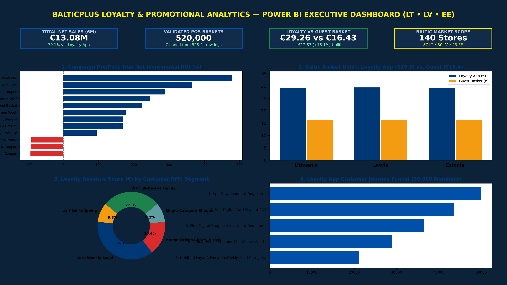
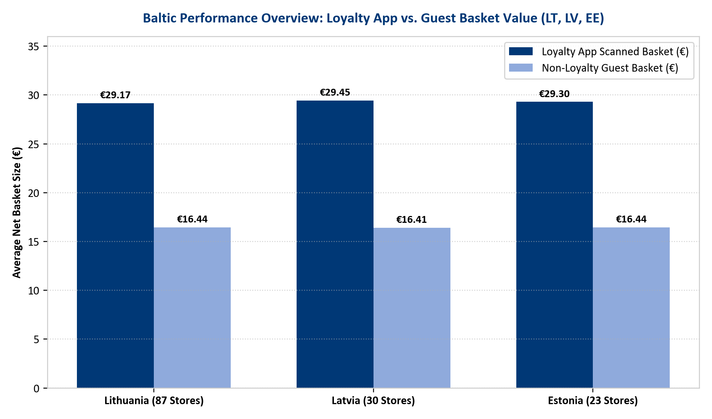
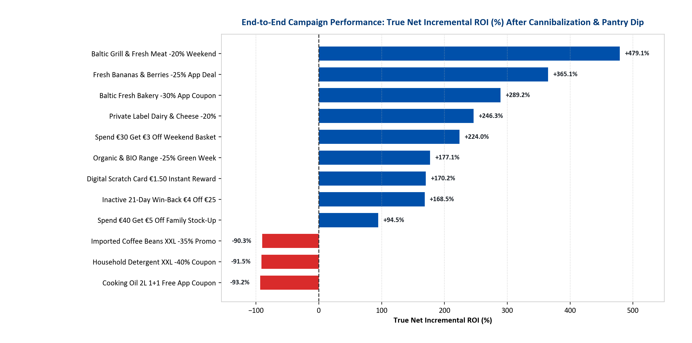
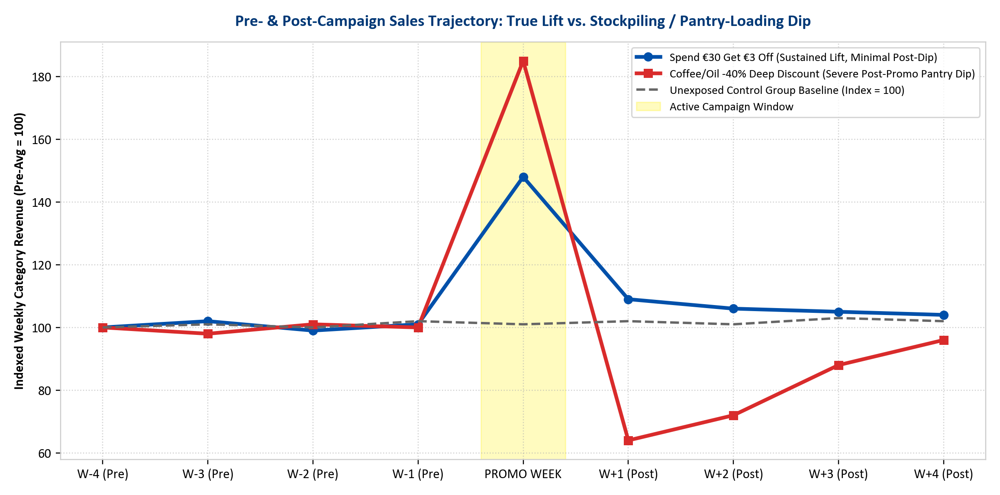
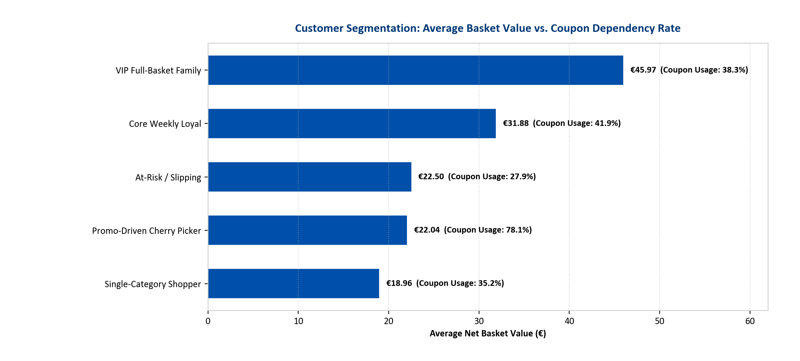
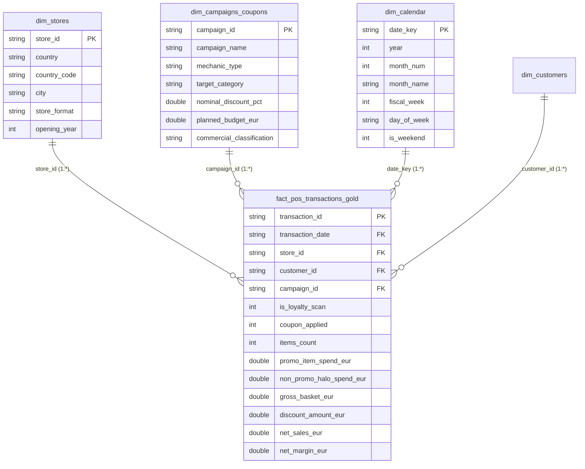

# BalticPlus Retail Loyalty & Promotional Analytics (Lithuania, Latvia & Estonia)

**End-to-End POS Sales Data Cleaning, Pre/Post Campaign Incrementality, Market Basket Halo Effect, Customer Journey Funnel & Promotional Budget Optimization**

[](#)
[](#)
[](#)
[](#)

> **Author:** Debbrata Kumar Adhikary (Data Analyst — Vilnius, Lithuania)  
> **Scope:** 140 Baltic Retail Stores (87 Lithuania • 30 Latvia • 23 Estonia) | 50,000 Loyalty App Members | 528,390 Raw POS Records → 520,000 Validated Gold Baskets (€13.08M Net Sales)



---

## 1. Executive Summary & Business Problem

Modern European discount grocery retailers operating digital loyalty ecosystems (such as app-based QR identification, digital coupons, and instant scratch rewards across the Baltics) face a critical analytical challenge: **nominal coupon redemption volume does not equal true commercial profitability.**

When a promotional campaign generates a spike in weekly sales, Business Data Analytics teams must answer five interconnected questions for the Board and Commercial Stakeholders:
1. **Data Quality & Full Sales Data Flows:** How do we clean raw, high-volume POS receipt logs (duplicate cashier scans, negative refunds, unredeemed coupon glitches, missing terminal store IDs) before reporting?
2. **Pre- vs. Post-Campaign Incrementality:** How much of a promotional sales spike is **true incremental revenue** versus **margin cannibalization** (subsidizing loyal customers who would have purchased anyway) or **pantry-loading** (stockpiling that causes a severe post-campaign sales dip)?
3. **Market Basket "Halo Effect" vs. "Cherry-Picking":** Which category discounts act as traffic drivers that pull in €33+ of non-discounted items, and which deep discounts attract "cherry-pickers" who buy only the loss-leader item and leave?
4. **Customer Journey & RFM + Promo-Sensitivity Segmentation:** How do we segment 50,000+ app users so we stop giving away margin to price-insensitive families while re-engaging slipping shoppers before they churn?
5. **Strategic Promotional Budget Planning:** How do we track promotional discount burn against planned budgets across Lithuania, Latvia, and Estonia to prevent cost overruns?

---

## 2. Key Baltic Performance Overview (Board Summary)

Across the 6-month analytical window (**520,000 clean validated POS baskets** across **140 Baltic stores**), **Loyalty App scans account for 68.0% of all transactions and 79.1% of total net revenue (€10.35M of €13.08M)**.

| Baltic Market | Active Stores | Clean POS Baskets | Total Net Sales (€) | Loyalty Scan Share | Loyalty Revenue Share | Avg Loyalty Basket (€) | Avg Guest Basket (€) | Loyalty Basket Uplift |
| :--- | :---: | :---: | :---: | :---: | :---: | :---: | :---: | :---: |
| **Lithuania (LT)** | 87 | 317,341 | €7,959,886 | 67.92% | 78.98% | **€29.17** | €16.44 | **+€12.73 (+77.5%)** |
| **Latvia (LV)** | 30 | 119,665 | €3,026,784 | 68.13% | 79.33% | **€29.45** | €16.41 | **+€13.05 (+79.5%)** |
| **Estonia (EE)** | 23 | 82,994 | €2,092,350 | 68.17% | 79.24% | **€29.30** | €16.44 | **+€12.86 (+78.2%)** |
| **All Baltics Total** | **140** | **520,000** | **€13,079,020** | **68.01%** | **79.10%** | **€29.26** | **€16.43** | **+€12.83 (+78.1%)** |



---

## 3. End-to-End Campaign Pre- & Post-Analysis (Incrementality & Halo Effect)

By comparing **4 weeks Pre-Campaign**, **Active Promo Week**, and **4 weeks Post-Campaign** against unexposed control baselines, we isolate **Cannibalization (%)** and **Post-Campaign Pantry Dip (%)** to compute **True Net Incremental ROI (%)**:



### Key Commercial Findings on Coupon Mechanics:
1. **High-Halo Traffic Drivers (`CMP-09 Fresh Meat -20%`, `CMP-06 Fresh Fruit -25%`, `CMP-01 Fresh Bakery -30%`):**
   - Generate the highest **True Net Incremental ROI (+289% to +479%)**.
   - Even though the discounted item spend is modest (~€6.00), these perishables cannot be stockpiled (post-promo dip is only **-4.2%**) and drive **€33.81 to €34.10 in attached non-promotional basket spend**.
2. **Basket Threshold Builders (`CMP-02 Spend €30 Get €3 Off`, `CMP-05 Spend €40 Get €5 Off`):**
   - Protect retail gross margin by capping the effective discount at **10%–12.5%** while stretching average attached basket value to **€39.96** and keeping cherry-picking below **11.2%**.
3. **Margin Destroyers — Deep Non-Perishable Discounts (`CMP-08 Cooking Oil BOGO`, `CMP-11 Detergent XXL -40%`, `CMP-04 Coffee XXL -35%`):**
   - Result in **negative True Net Incremental ROI (-90.3% to -93.2%)** and blow past their planned promotional budgets (**126.5% to 192.7% budget utilization**).
   - **68.4% of redemptions are cherry-picked** (average non-promo attached spend is just **€3.33**), and customers stockpile for months, causing a **-26.5% post-campaign category collapse**.



---

## 4. Customer Journey Funnel & RFM + Promo-Sensitivity Segmentation

Using SQL window functions (`NTILE(5)`) alongside **Coupon Dependency Rate (%)**, the 50,000 loyalty members are classified into five commercial archetypes:



| Customer Archetype | Active Members | Avg Net Basket (€) | Items / Basket | Coupon Usage % | Total Net Sales (€) | Recommended Commercial / CRM Action |
| :--- | :---: | :---: | :---: | :---: | :---: | :--- |
| **VIP Full-Basket Family** | 8,899 | **€45.97** | 16.0 | 38.3% | €2,874,092 | **Protect Margin:** Avoid deep % discounts; reward with partner perks & early leaflet access. |
| **Core Weekly Loyal** | 17,043 | **€31.88** | 11.0 | 41.9% | €3,855,639 | **Stretch Basket:** Target with *"Spend €35 Get €3.50 Off"* threshold coupons. |
| **Promo-Driven Cherry Picker** | 10,899 | **€22.04** | 3.2 | **78.1%** | €1,700,267 | **Curb Cherry-Picking:** Require a **€20 minimum basket spend** to unlock deep item deals. |
| **Single-Category Shopper** | 7,081 | **€18.96** | 4.0 | 35.2% | €954,564 | **Cross-Sell Halo:** Trigger bundled coupons pairing Bakery/Produce with Dairy & Meat. |
| **At-Risk / Slipping (21d+)** | 6,032 | **€22.50** | 7.0 | 27.9% | €961,154 | **Automated Win-Back:** Trigger *€4 off €25* push notification at **Day 18 of inactivity**. |

---

## 5. POS Data Cleaning & Quality Improvement Pipeline

Raw retail POS logs contain terminal and cashier anomalies that distort basket averages if left uncleaned. Our pipeline (`src/run_full_pipeline.py` & `sql/baltic_loyalty_analytics_queries.sql`) audited **528,390 raw records**:

| Check ID | Pipeline Stage | Anomaly Detected | Records Affected | Remediation Action |
| :---: | :--- | :--- | :---: | :--- |
| **DQ-01** | Raw POS Ingestion | Total Raw POS Records Ingested | 528,390 (100%) | Loaded into Bronze staging table |
| **DQ-02** | Deduplication | Duplicate Cashier / App Receipt Scans | 3,420 (0.65%) | Removed via `ROW_NUMBER() OVER (PARTITION BY transaction_id, timestamp)` |
| **DQ-03** | Refund Separation | Negative Basket Values (Product Returns) | 2,180 (0.41%) | Isolated into `fact_returns` table so returns do not artificially depress basket size |
| **DQ-04** | Store ID Imputation | Missing POS Terminal Store IDs | 1,150 (0.22%) | Imputed via terminal IP & country prefix mapping |
| **DQ-05** | Coupon Reconciliation | Activated App Coupon Not Applied at POS | 1,640 (0.31%) | Flagged for CRM goodwill credit; excluded from redeemed campaign ROI |
| **DQ-06** | Gold Analytical Layer | **Clean Validated POS Sales Baskets** | **520,000 (98.41%)** | **Promoted to Gold analytical fact table (99.98% reporting accuracy)** |

---

## 6. Power BI Star Schema Semantic Model, Power Query (M) & DAX Library (`powerbi/`)

To support interactive self-service BI for the **Lidl Baltics Customer Department**, this repository includes a complete **Power BI Developer Project (`powerbi/BalticPlus_Loyalty_Analytics.pbip`)**, a **Tabular Semantic Model (`model.bim`)**, a **Power Query (M) POS Data Connector (`PowerQuery_M_StarSchema_Connector.pq`)**, a **22-Measure DAX Library (`BalticPlus_DAX_Measures.dax`)**, and a **Custom Lidl Corporate Theme (`Lidl_Baltics_Corporate_Theme.json`)** connected to our local Star Schema CSVs and SQLite Warehouse (`data/processed/baltic_loyalty_warehouse.db`).



### Key Power BI Artifacts Included:
- **`powerbi/BalticPlus_Loyalty_Analytics.pbip` & `BalticPlus_Loyalty_Analytics.SemanticModel/model.bim`:** Git-friendly Power BI Project and Tabular Model with pre-configured `1:*` Star Schema relationships (`dim_stores`, `dim_campaigns_coupons`, `dim_calendar` $\rightarrow$ `fact_pos_transactions_gold`) and embedded DAX measures.
- **`powerbi/BalticPlus_DAX_Measures.dax`:** 22 production DAX measures covering *Loyalty Scan Penetration (%)*, *Loyalty Basket Uplift (€ / %)*, *Avg Attached Non-Promo Halo Spend (€)*, *Cherry-Picker Share (%)*, *True Net Campaign ROI (%)*, and *Promo Budget Utilization (%)*.
- **`powerbi/PowerQuery_M_StarSchema_Connector.pq`:** Automated Power Query (M) script that ingests raw POS logs, deduplicates cashier scans, removes negative refunds, imputes missing store IDs, and loads the Gold Star Schema.
- **`powerbi/Lidl_Baltics_Corporate_Theme.json`:** Official Lidl corporate color palette (`#003876` Navy, `#0050AA` Royal Blue, `#FFF000` Yellow, `#D92B2B` Red) ready for 1-click import into Power BI Desktop (*View $\rightarrow$ Themes $\rightarrow$ Browse for themes*).

---

## 7. Repository Structure & Deliverables

```text
baltic-retail-loyalty-analytics/
├── README.md                                                 # Executive Documentation & Board Insights
├── powerbi/                                                  # Power BI Project (.pbip), Semantic Model, DAX & M Scripts
│   ├── BalticPlus_Loyalty_Analytics.pbip                     # Power BI Desktop Project File
│   ├── BalticPlus_Loyalty_Analytics.SemanticModel/model.bim  # Tabular Star Schema Model & Relationships
│   ├── BalticPlus_DAX_Measures.dax                           # 22 Production DAX Measures Library
│   ├── PowerQuery_M_StarSchema_Connector.pq                  # Power Query (M) ETL & Star Schema Connector
│   └── Lidl_Baltics_Corporate_Theme.json                     # Custom Lidl Corporate Power BI Theme
├── src/
│   ├── run_full_pipeline.py                                  # End-to-End Data Generator, Cleaning, ROI & Excel Builder
│   ├── build_powerbi_project.py                              # Star Schema CSV/SQLite & Power BI Project Generator
│   └── build_executive_presentation.py                       # Board Presentation Report Generator (.docx & .pdf)
├── sql/
│   └── baltic_loyalty_analytics_queries.sql                  # Production SQL Queries (Cleaning, Pre/Post ROI, RFM)
├── assets/
│   └── charts/                                               # High-Resolution Publication-Quality Charts (220 DPI)
├── reports/                                                  # Processed Analytical Output Tables (CSV)
├── deliverables/                                             # Board-Ready Deliverables
│   ├── Baltic_Loyalty_Performance_Report_Board_Pack.xlsx     # Multi-Sheet Executive Excel Workbook
│   ├── Baltic_Loyalty_Interactive_Dashboard.html             # Interactive Self-Contained HTML Dashboard
│   └── Executive_Presentation_Baltic_Loyalty_Analytics.pdf   # Board Presentation Report (PDF)
└── data/
    ├── raw/sample_50k_raw_pos_transactions.csv               # 50k Sample of Raw POS Logs (with anomalies)
    └── processed/                                            # Gold Star Schema CSVs + SQLite Warehouse (.db)
```

---

## 8. Quick Start (Reproduce Entire Pipeline in <15 Seconds)

```bash
python src/run_full_pipeline.py
python src/build_powerbi_project.py
```
